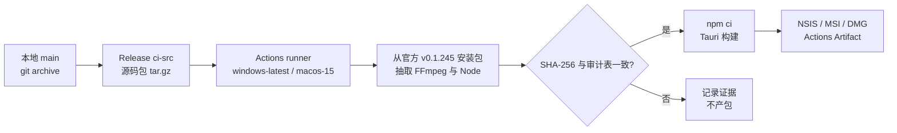

<p align="center"></p>

<h1 align="center">HachimoDock-beautiful</h1>

<p align="center">
  <a href="https://github.com/ai-maker-lab/HachimoDock"></a>
  
  
  <a href="https://github.com/laochenfei233/HachimoDock-beautiful/actions/workflows/build-installers.yml"></a>
</p>

<p align="center">HachimoDock 的非官方构建分支：在公开审计链路上产出 Windows 安装包，并为应用内「应用更新」面板提供发版渠道。</p>

## 这不是官方版本

- 本仓库是 [HachimoDock](https://github.com/ai-maker-lab/HachimoDock) 的**个人非官方分支**，与上游作者无隶属、合作或背书关系。
- 依据上游许可证第 4、5 条，本分支明确标注为修改版本，不冒充官方发布；品牌与标识不随源码授权。
- 安装包由本仓库的 GitHub Actions 从本分支源码构建，**没有**上游的签名与公证（见下方「平台支持现状」）。
- 需要官方版本请前往 [上游 Releases](https://github.com/ai-maker-lab/HachimoDock/releases)。

## 这个仓库里有什么

本仓库即 HachimoDock 的完整源码分支（含全部提交历史），在同步上游 0.1.245 的基础上包含本地功能改动与构建流水线：

| 内容 | 位置 | 说明 |
|---|---|---|
| 完整源码与历史 | 本仓库 main 分支 | 与上游 0.1.245 同步，叠加本地功能改动；原始上游说明见 [docs/README-upstream.md](docs/README-upstream.md) |
| 构建流水线 | `.github/workflows/build-installers.yml` | Windows x64 出包；macOS / Windows arm64 在门禁处留证（见「平台支持现状」） |
| 安装包产物 | Actions → 运行记录 → Artifacts | 每次成功构建产出 NSIS 安装器与 MSI，保留期以 GitHub 默认策略为准 |

## 快速开始

**只想装起来用**：打开 [Actions 构建记录](https://github.com/laochenfei233/HachimoDock-beautiful/actions/workflows/build-installers.yml)，进入最新一次成功运行，在页面底部下载 `windows-x64-installers`，解压后运行 NSIS 安装器（未做 Authenticode 签名，系统可能提示未知发布者）。

也可以用 GitHub CLI 下载最近一次构建产物：

```sh
gh run download --repo laochenfei233/HachimoDock-beautiful --name windows-x64-installers
```

**想自己触发一次构建**：

```sh
gh workflow run build-installers.yml --repo laochenfei233/HachimoDock-beautiful
gh run watch --repo laochenfei233/HachimoDock-beautiful
```

构建全部在 GitHub 托管 runner 上完成，本地不需要 Windows 或 macOS 环境。

## 构建流水线

流水线只信任可核验的输入：源码包来自本仓库 Release，LGPL FFmpeg 与 Node 运行时从**官方已发布安装包**里抽取，并按源码中的审计表逐字节校验 SHA-256；校验不过就不出包。



审计表在源码 `pc/scripts/prepare-desktop-resources.mjs` 的 `auditedFfmpegBinarySha256` 中，目前只有两项：`windows-x64` 与 `macos-arm64`。这是安全门禁，不是可以绕过的构建开关。

## 平台支持现状

| 目标 | 状态 | 说明 |
|---|---|---|
| Windows x64 | 可构建 | 产出 NSIS 与 MSI；实测约 147 MB / 184 MB。安装器未签名 |
| macOS arm64 | 被运行时门禁拦下 | 官方 macOS 安装包内的 Node 构建不在已评审的 Node 26.7.0 许可清单中，FFmpeg 哈希（`89c2d30b…`）也与审计表（`ec8356f0…`）不符——公开数据无法复现出已评审的运行时 |
| macOS x64 | 被运行时门禁拦下 | 官方运行时是 arm64，x64 目标在源码的运行时架构校验处被直接拒绝；审计表也没有 `macos-x64` 条目 |
| Windows arm64 | 被打包器门禁拦下 | 源码准备阶段明确只支持 Windows x64，arm64 目标在准备阶段被直接拒绝 |

这三个目标各有对应的探针任务：走真实流水线、把门禁拒绝的原始日志保存为 Artifact，因此运行记录保持绿色又能看到具体原因，且绝不会产出未经审计的安装包。要解锁 macOS arm64，需要先提供已评审的 Node 26.7.0 构建，并在 macOS 上重建 FFmpeg 8.1.3（`h264_videotoolbox`，须 `--disable-gpl`），再把两者加入对应的许可/审计清单；macOS x64 与 Windows arm64 还需要先让运行时与打包器支持对应架构。

## 相对上游的改动

本分支在同步上游 0.1.245 的基础上，主要包含：

- **应用更新面板**：设置页新增「应用更新」卡片，查询本仓库 Releases，显示发布说明，支持应用内下载与启动安装器；发布与否由本仓库的 Release 决定。
- **桌面 Agent 扩展**：在 Codex、Claude、WorkBuddy、DeepSeek Harness 之外，增加 Prism 与 ZCode 的状态跟随与当前可见输入框语音草稿；Prism 的设备气泡选择经其桥接插件切换桌面对话。
- **多服务商语音**：语音识别与语音合成可分别选择豆包、通义千问、MiMo 或自定义兼容端点，凭据按服务商隔离，切换不串用。
- **界面改版**：Apple 风格浅色/深色双主题（跟随系统），橙色猫形象贯穿图标、侧边栏与 favicon。

上述改动的设计与验收记录随源码包一起提供（`docs/compose/specs/`）。

## 许可证

本分支沿用上游的 [HachimoDock 项目许可证 1.0](LICENSE)：源码可见但**不是** GPL、MIT 或其他标准开源许可，仅授权非商业使用；再分发必须附带许可证并保留版权声明；修改版本必须清楚标注修改事实，不得暗示官方版本。第三方组件、字体与素材继续适用其各自许可证。

## 致谢

上游项目 [ai-maker-lab/HachimoDock](https://github.com/ai-maker-lab/HachimoDock)：连接设备的宠物形象、任务气泡与语音交互体验都来自上游。本分支只做构建自动化与界面/集成方面的个人改动。
